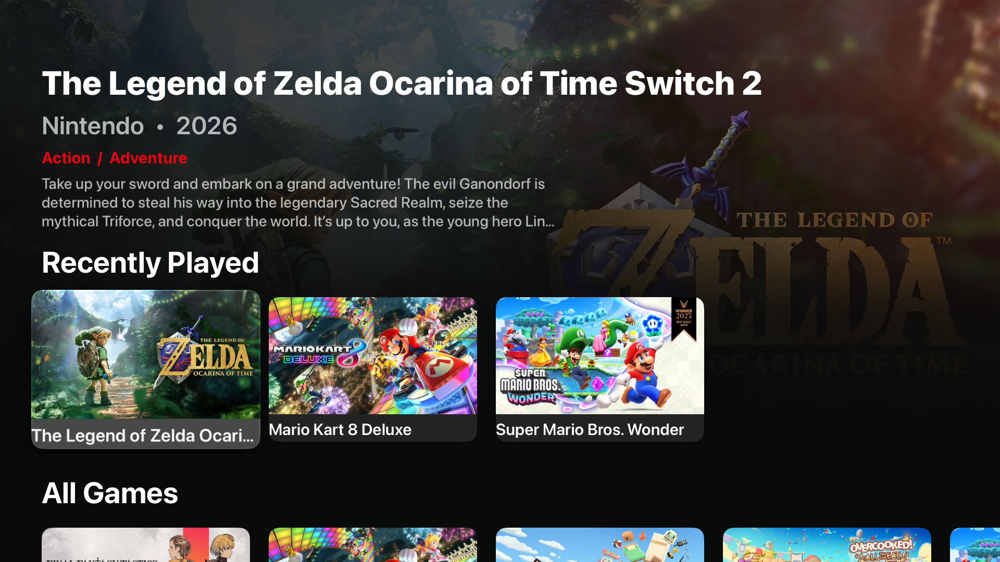
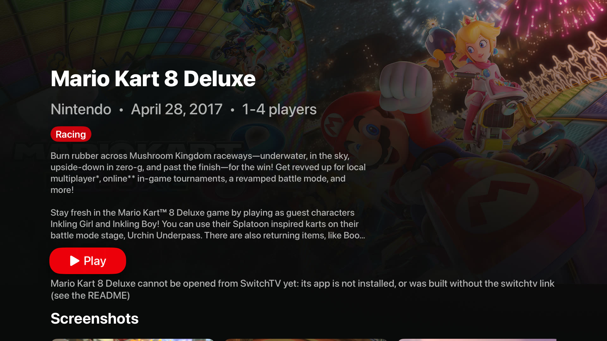
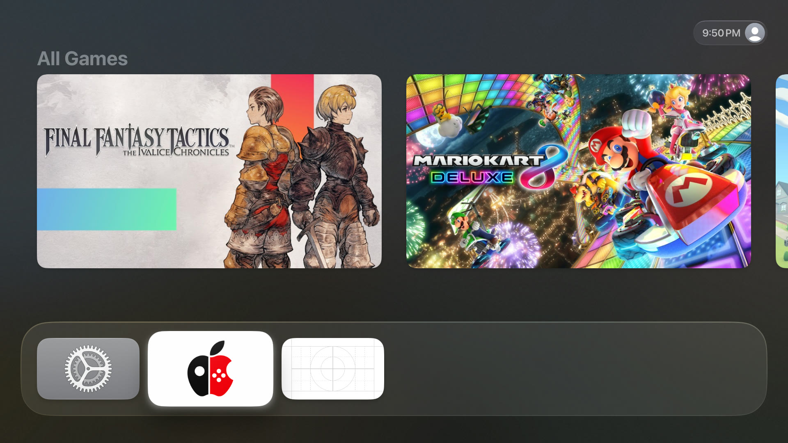

# SwitchTV

What changed in each release: [CHANGELOG.md](CHANGELOG.md) and [Releases](https://github.com/brad-n/SwitchTV/releases).

SwitchTV is an Apple TV app that lists the Nintendo Switch games you have built for your Apple TV, with their box art, and opens them. It has a big banner for the game you are on, a Recently Played row, All Games, a row for each genre, a details page for each game (description, publisher, release date, players, screenshots), and a Top Shelf on the Apple TV home screen.



| Details page | Top Shelf on the home screen |
| --- | --- |
|  |  |

*Screenshots are from the tvOS Simulator with six games listed. No game apps are installed there, so the details page says the game cannot be opened yet, and the Top Shelf shows All Games only.*

SwitchTV does not run games, include games, or build them. It is a launcher: it shows you the games you already have and opens their apps.

## What you need

- An Apple TV 4K on tvOS 17 or later, paired with your Mac in Xcode (Xcode > Window > Devices and Simulators).
- A Mac with Xcode, and [XcodeGen](https://github.com/yonaskolb/XcodeGen) (`brew install xcodegen`). Python 3.9 or later; the build tool uses nothing but Python's standard library.
- An Apple ID signed in under Xcode > Settings > Accounts, and its 10-character team ID (Xcode shows it next to your team; it looks like `ABCDE12345`).
- Games to list. See the next two sections: SwitchTV lists any game, but it can only **open** games whose app was built with a small addition.

## Build it and put it on your Apple TV

```sh
git clone https://github.com/brad-n/SwitchTV.git
cd SwitchTV
python3 switchtv.py build --games my-games.json --team ABCDE12345
xcrun devicectl list devices                      # find your Apple TV's name
python3 switchtv.py install --device "Living Room"
```

`my-games.json` is your list of games (next section). `--team` can also be the environment variable `SWITCHTV_TEAM`. The first build downloads a public list of Switch games (about 90 MB, once) for descriptions and art; games the list does not have (Nintendo Switch 2 games) are looked up on Nintendo's own store.

Run the same two commands again whenever your games change. To try SwitchTV without an Apple TV, build for the tvOS Simulator (no team needed, nothing is signed):

```sh
python3 switchtv.py build --games my-games.json --simulator
python3 switchtv.py install --simulator          # into the Simulator that is booted
xcrun simctl launch booted dev.tvport.simulator00.switchtv
```

## Add your games

You can tell SwitchTV about your games in three ways, alone or together:

1. **A games file** (`--games my-games.json`):
   ```json
   {"games": [
     {"titleID": "0100152000022000", "name": "Mario Kart 8 Deluxe"},
     {"titleID": "010015100B514000", "name": "Super Mario Bros. Wonder",
      "bundleID": "com.example.wonder", "artwork": "art/wonder.jpg"}
   ]}
   ```
   `titleID` (16 hexadecimal digits) and `name` are all that is needed. Optional: `bundleID` (the game app's bundle ID), `artwork` (a picture of your own, a path relative to the file; without it SwitchTV uses the shop banner), `artworkSource` (the shop banner address your artwork came from, so the matching product is picked when there are several).
2. **A folder of built game apps** (`--apps-dir ~/Games/apps`): every `.app` and `.ipa` in it is read through its `Info.plist`. A game is recognised by its 16-digit title ID, found in this order: its URL scheme `switchtv-<title ID>`, an Info.plist key `SwitchTitleID`, or a 16-digit title ID in its bundle ID (the form `...g0100152000022000`). Apps without one are skipped, with a note.
3. **The apps already on your Apple TV** (`--tv-apps "Living Room"`): asks the Apple TV for its apps with `xcrun devicectl device info apps` and lists the ones whose bundle ID carries a title ID as above. `--tv-apps-json FILE` reads a saved copy of that output instead (`xcrun devicectl device info apps --device NAME --json-output FILE`).

`python3 switchtv.py catalog ...` takes the same options and only makes the catalogue (`Catalog/catalog.json` and the pictures), so you can look at it first. Pass `--offline` to fetch nothing.

## Which games SwitchTV can open

**Games built by [Brad's TVPort fork](https://github.com/brad-n/TVPort) can be opened from SwitchTV and show up in Recently Played. Games from any other build are listed, with their art and details, but cannot be opened from SwitchTV, and have no Recently Played, until their app carries the two additions below.** SwitchTV says so on the game's page instead of doing nothing.

### What a game build needs

Any tool that builds a game app for the Apple TV can add these. Use the **same team** for the game and for SwitchTV.

**1. A URL scheme, so SwitchTV can open the game.** In the game app's `Info.plist`:

```xml
<key>CFBundleURLTypes</key>
<array>
  <dict>
    <key>CFBundleURLName</key><string>your.game.bundle.id</string>
    <key>CFBundleURLSchemes</key>
    <array><string>switchtv-0100152000022000</string></array>
  </dict>
</array>
```

The scheme is `switchtv-` followed by the game's title ID **in lowercase**. SwitchTV opens `switchtv-<title ID>://play`; the app only has to come to the front, so it needs no code to handle the link.

**2. Recently Played, through a shared keychain item.** Entitlement of the game app (and the game must be signed with a team's profile that allows it; a wildcard profile from Xcode's automatic signing does):

```xml
<key>keychain-access-groups</key>
<array><string>ABCDE12345.dev.tvport.switchtv</string></array>
```

`ABCDE12345` is your team ID. When the game comes to the front it writes one keychain item:

| Keychain attribute | Value |
| --- | --- |
| class | generic password (`kSecClassGenericPassword`) |
| service (`kSecAttrService`) | `dev.tvport.switchtv` |
| account (`kSecAttrAccount`) | the title ID in **capitals**, for example `0100152000022000` |
| access group (`kSecAttrAccessGroup`) | `ABCDE12345.dev.tvport.switchtv` |
| value (`kSecValueData`) | the time in Unix seconds, as text, for example `1730000000` |
| accessible (`kSecAttrAccessible`) | after first unlock |

Update the item if it exists, add it if not. A reference implementation, from the TVPort fork, is `dm/ios/SourcesTV/TVLastPlayed.m` in the [TVPort fork](https://github.com/brad-n/TVPort); `Shared/SharedStore.swift` in this repo reads the same items, and `tests/test_shared_code.py` checks they agree. If the group is missing the keychain refuses and nothing happens, so adding this to a game is harmless where it does not apply.

A different group name is possible: build SwitchTV with `--group-name` and give the games the same one.

## For developers

### Layout

```
switchtv.py              the command line tool: catalog | build | install
switchtv_cli/            catalog.py (catalogue, titledb, fingerprint, project values), inputs.py (games file,
                         apps folder, devicectl), build.py (project staging, icons, xcodegen, xcodebuild,
                         install), nintendo_store.py (Switch 2 art and details from Nintendo's store)
Sources/ Shared/ TopShelf/ project.yml   the tvOS app, the code the app and its Top Shelf share, the Top Shelf extension, the XcodeGen spec
Branding/                the logo and the script that cuts the icon out of it
tools/tv_icon.swift      icon layering for tvOS (vendored, see below)
tests/                   unit tests (Python unittest) and fixtures
```

### How a build works

`build` copies the app's files to a folder in the cache (`<cache>/project`; `project-simulator` for the Simulator), adds `Catalog/` (the catalogue and its pictures, which the app and the Top Shelf bundle), makes the App Icon and Top Shelf images from `Branding/switchtv-icon-source.png`, fills in the `${SWITCHTV_*}` values of `project.yml` (bundle ID `<prefix>.<team>.switchtv`, the keychain group `<team>.dev.tvport.switchtv`, the team, a build number) and the `LSApplicationQueriesSchemes` list (one `switchtv-<title ID>` per game, because `canOpenURL` answers false for a scheme that is not listed), runs `xcodegen`, then `xcodebuild`. Your checkout is never written to. Options: `--team` / `SWITCHTV_TEAM`, `--bundle-prefix` / `SWITCHTV_BUNDLE_PREFIX` (default `dev.tvport`), `--group-name`, `--device` (build for one Apple TV), `--simulator`, `--cache` / `SWITCHTV_CACHE` (default `~/Library/Caches/SwitchTV`), `--out` (the catalogue folder, default `./Catalog`). `--json` prints a one-line JSON summary last (game count, fingerprint, app path) for other tools.

The fingerprint in that summary identifies what an installed SwitchTV was made from: the catalogue, its pictures and the app's own files. A tool that installs SwitchTV can skip the install when it has not changed; TVPort does.

### The catalogue

`catalog.json` has one record per game: `titleID`, `name`, `publisher`, `releaseDate`, `numberOfPlayers`, `genres`, `description`, `intro`, `bundleID`, `scheme`, `card` and `banner` (paths of the pictures in `images/`) and `screenshots`. Fields the sources do not have are `null` or empty and the app leaves them out. Information and art come from [blawar/titledb](https://github.com/blawar/titledb)'s US list, then Nintendo's store for games it lacks a banner for, and your own `artwork` first. Everything fetched is cached in the cache folder.

### Tests

```sh
python3 -m unittest discover -s tests -t .
```

They cover the catalogue and its fingerprint, the project values, each input (games file, `.app` and `.ipa` Info.plists, a recorded `devicectl` output in `tests/fixtures/devicectl-apps.json`), the command line with Xcode and `devicectl` replaced by stand-ins, the Nintendo store reader against a saved page, and the Swift code the app and Top Shelf share (compiled and run with `swiftc`, macOS only). None of them need the network, Xcode projects, or an Apple TV. The fixture `devicectl-apps.json` was written by hand in the shape of devicectl's JSON; it is not a recording from a real device.

### Used by TVPort

The [TVPort fork](https://github.com/brad-n/TVPort) includes this repo as a git submodule (`tvport/switchtv`) and calls `switchtv.py` after each Build & Install, with its library written as a games file. SwitchTV does not need TVPort.

## Credits and license

MIT, Copyright (c) 2026 Brad Norman. See [LICENSE](LICENSE).

`tools/tv_icon.swift` is copied unchanged from the TVPort project, written by its contributors (git history: 0to101, 68hctmzzjf-svg and Brad Norman) and used under TVPort's MIT license, "Copyright (c) 2026 seedds"; the notice is in [LICENSE](LICENSE) and [tools/tv_icon.LICENSE](tools/tv_icon.LICENSE).

Game information and pictures belong to their owners; SwitchTV fetches them from public lists and Nintendo's web store for your own use. Nintendo Switch is a trademark of Nintendo. SwitchTV is not affiliated with or endorsed by Nintendo.
